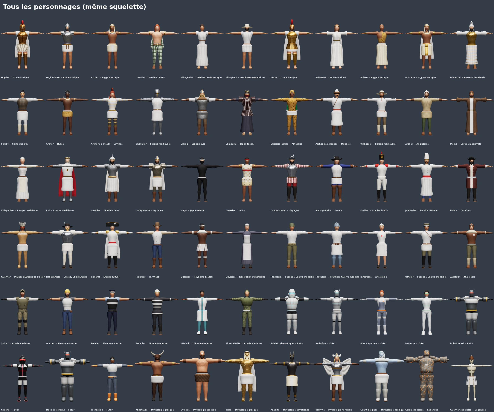

# Unités 3D pour jeu de stratégie — de l'Antiquité au futur

Catalogue complet d'unités low poly prêtes pour le jeu, dans un style semi-réaliste stylisé (proportions
normales, carrures héroïques, silhouettes lisibles de loin, textures peintes), rangées par ère et par
culture. Tout est fabriqué par programme (`fabriquer.py`) : on retouche et on régénère sans logiciel 3D.



| Famille | Nombre | Contenu |
|---|---|---|
| Personnages | 66 | infanterie, tireurs, cavaliers, prêtres et soigneurs, héros, éclaireurs, villageois (hommes et femmes), créatures mythologiques |
| Montures | 6 | cheval de selle, cheval de guerre caparaçonné, cheval blanc, chameau, éléphant de guerre, loup |
| Machines et véhicules | 12 | bélier, catapulte, baliste, trébuchet, tour de siège, canon, char 1940, jeep, char moderne, hélicoptère, char antigravité, chasseur-drone |
| Navires | 8 | trirème, drakkar, jonque, barque de pêche, galion, cuirassé, vedette, croiseur futuriste |
| Accessoires | 70 | armes, boucliers, outils et objets de toutes les époques |

Liste détaillée (fichiers, triangles, os animables, arme conseillée par personnage) : `sortie/CATALOGUE.md`.

## Les ères et les cultures

- **Antiquité** : Grecs (hoplite, héros, prêtresse), Romains (légionnaire), Égyptiens (archer, prêtre, pharaon),
  Celtes, Perses (Immortel), Chinois des Qin, Nubiens, Scythes (archère à cheval), villageois et villageoise.
- **Moyen Âge** : chevalier, roi, moine, archer anglais, villageois et villageoise d'Europe ; Vikings ;
  samouraï et ninja ; guerrier jaguar aztèque, guerrier inca ; archer des steppes mongol ; cavalier arabe ;
  cataphracte byzantin.
- **Époque moderne** : conquistador, mousquetaire, hallebardier, fusilier et général de l'Empire, janissaire
  ottoman, pirate, guerrier des Plaines.
- **Ère industrielle** : pionnier du Far West, guerrier zoulou, ouvrière.
- **XXe siècle** : fantassin de 1914 et de 1940, officier, aviateur, infirmière.
- **Contemporain** : soldat, tireur d'élite, policier, pompier, médecin, ouvrier de chantier.
- **Futur** : soldat cybernétique, cyborg, androïde, robot lourd, méca de combat (géant), pilote spatiale,
  médecin, technicien.
- **Mythologie** : minotaure, cyclope, titan, géant de glace, anubite, valkyrie, golem de pierre, guerrier squelette.

## Ce que respecte chaque personnage

- **Pose en T** : bras horizontaux, paumes vers le bas, pieds légèrement écartés, face à l'avant ; sans socle,
  sans arme en main (armes à part).
- **6 000 à 10 000 triangles**, un seul matériau, **une seule texture 2048 × 2048** (couleur de base + rugosité ;
  dans le `.glb`, rugosité et métal sont réunis selon la norme glTF : vert = rugosité, bleu = métal).
- **Couleur du joueur** : capes, tuniques, tabards, manches, plaques, caparaçons, voiles, faces de boucliers,
  drapeaux peints en gris clair uni ; un masque (`textures/*_couleur_joueur.png`, blanc = à teinter) sert à la
  teinte dans le moteur : `couleur = base × lerp(1, couleur_joueur, masque)`.
- **Le même squelette pour tous** : 65 os, noms et hiérarchie Mixamo (`mixamorig:Hips`… doigts compris),
  4 influences au plus par sommet. Une animation faite pour un personnage marche pour tous. Les géants
  (minotaure ×1,35, cyclope ×1,6, géant de glace ×1,8, titan ×2,2, golem ×1,5, méca ×3) ont le même
  squelette agrandi : mêmes noms, mêmes animations.

## Montures, machines, navires

- **Montures** : squelette de quadrupède commun (bassin, colonne, cou, tête, queue, quatre pattes à quatre os,
  oreilles ; trompe pour l'éléphant) ; os `Saddle` = point d'attache du cavalier (n'importe quel personnage,
  avec une animation assise).
- **Machines et véhicules** : chaque pièce mobile a son os, à tourner dans le moteur : roues (`Wheel_*`),
  bras de lancement (`Arm`), contrepoids (`Weight`), bélier (`Ram`), rampe (`Ramp`), tourelle (`Turret`),
  canon (`Barrel`), chenilles (`Track_*`), rotors (`Rotor`, `TailRotor`), réacteurs (`Engine_*`).
- **Navires** : coque (`Root`), voiles (`Sail*`) pour le vent, bancs de rames (`Oars_L`, `Oars_R`), tourelles et
  canons (`Turret*`, `Gun*`). Ligne de flottaison à y = 0.
- 300 à 10 000 triangles selon la taille ; texture 2048 (1024 pour les plus petits).

## Accessoires : comment les attacher

Origine = point de prise (milieu de la poignée), axe principal vers +Y (lame, pointe ou canon vers le haut).
Boucliers : origine à la poignée, face vers +Z. Dans le moteur, attacher l'arme à l'os `mixamorig:RightHand`
(bouclier : `mixamorig:LeftForeArm`) par un point d'attache (socket) et régler une fois la rotation par type
d'arme. Pour un géant, agrandir l'arme du même facteur que le personnage. Textures 512 px (1024 pour les
boucliers et l'étendard).

## Fichiers livrés (dans le zip)

```
personnages/<ère>/<id>/<id>.glb                 personnage riggé, textures intégrées
personnages/<ère>/<id>/textures/                couleur (JPEG), rugosité, métal, masque couleur du joueur (PNG)
personnages/<ère>/<id>/apercu.jpg               face, trois quarts, profil, dos
personnages/<ère>/<id>/apercu-couleur-joueur.jpg  même chose teinté en bleu
personnages/<ère>/<id>/portrait.jpg             vignette 512 × 512 pour l'interface du jeu
montures/, machines/, navires/, accessoires/    même organisation
apercus/                                        planches par ère et par famille, portraits
catalogue.json, CATALOGUE.md                    liste complète
```

Contrôle : les 162 fichiers passent le validateur officiel glTF (Khronos) sans erreur ni avertissement.

## Utilisation dans un moteur

- **Unity** : importer le `.glb` (paquet glTFast) ; personnages en Rig → Humanoid (correspondance Mixamo
  reconnue d'office, un seul Avatar pour tous) ; montures, machines et navires en Rig → Generic.
- **Unreal Engine 5** : importer le `.glb` (glTF Interchange), puis IK Retargeter vers le mannequin (un seul
  profil pour tous les personnages).
- **Godot 4** : import direct du `.glb`, BoneMap « SkeletonProfileHumanoid » pour les personnages.
- **Animations Mixamo** : télécharger « Without Skin » ; elles se reciblent par le nom des os. Mixamo
  n'accepte pas le `.glb` à l'envoi : pour utiliser son rig automatique, passer par Blender et un `.fbx`.

## Limites à connaître

- Jupes, robes, capes, tuniques et caparaçons sont rigides : sur un très grand pas, la cuisse peut traverser
  le tissu. Pour des capes qui flottent : simulation de tissu ou os supplémentaires.
- Mains en moufles (doigts serrés, pouce à part) avec tous les os des doigts : poings et prises
  fonctionnent, pas les gestes fins.
- Os à rotation nulle au repos : les outils de reciblage s'en accommodent, mais une animation Mixamo copiée
  telle quelle, sans reciblage, serait faussée.
- Visages peints (yeux, sourcils, bouche) : lisibles à la caméra d'un jeu de stratégie, pas pensés pour des
  gros plans de cinématique.
- Armes, machines et navires historiques simplifiés pour la lecture de loin (pas de répliques de musée).
- Les montures sont en pose debout : il faut des animations de quadrupède (marche, galop) faites pour ce
  squelette ; les animations humaines ne s'y appliquent pas.
- Pas de centaure ni de créature à corps non humain autre que les montures.

## Modifier ou ajouter

- Un personnage = une fonction dans `personnages.py`, `personnages2.py` ou `mythologie.py` (pièces de
  `corps.py` : casques, coiffes, armures, vêtements, chaussures, équipements, motifs ; silhouettes `HEROS`,
  `FEMME`, `ROBUSTE`, `SVELTE`…) et une ligne dans la liste `PERSONNAGES` du fichier (option
  `{'echelle': 1.5}` pour un géant).
- Une monture : `quadrupedes.py` ; une machine : `machines.py` ; un navire : `navires.py` ; un accessoire :
  `accessoires.py`.
- Fabriquer : `python3 design/3d/fabriquer.py` (tout, environ 6 min) ou `--seul viking,katana`. Le programme
  ajuste seul la finesse du maillage pour tenir le budget de triangles, refuse une unité sans zone de couleur
  du joueur et vérifie que chaque arme conseillée existe. Seuls numpy et Pillow sont nécessaires.
- Aperçus : `node design/3d/outils/apercus.js` (dans un dossier où `npm i three@0.170.0 playwright` a été
  fait), puis `python3 design/3d/outils/planches.py`, puis `python3 design/3d/fabriquer.py --emballer` pour
  le zip. Contrôle Khronos : `node design/3d/outils/valider.js design/3d/sortie` (`npm i gltf-validator`).

Fichiers du programme : `moteur.py` (squelettes, géométrie, poids, atlas, matières peintes, export glTF),
`corps.py` (pièces des personnages), `personnages.py`, `personnages2.py`, `mythologie.py`, `quadrupedes.py`,
`machines.py`, `navires.py`, `accessoires.py`, `fabriquer.py`, `outils/`.

Les fichiers fabriqués (`sortie/`, sauf les planches et le catalogue) ne sont pas versionnés : ils se
recréent à l'identique avec `fabriquer.py`.
