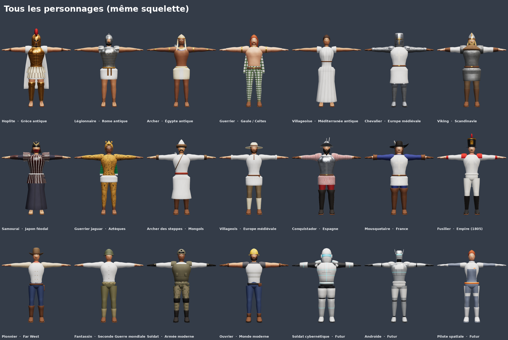

# Personnages et accessoires 3D — jeu de stratégie, de l'Antiquité au futur

21 personnages et 45 accessoires low poly prêts pour le jeu, dans un style semi-réaliste stylisé
(proportions normales, carrures héroïques, silhouettes lisibles de loin, textures peintes), rangés
par ère et par culture. Tout est fabriqué par programme (`fabriquer.py`) : on peut retoucher et
régénérer sans logiciel 3D.



## Contenu

| Ère | Personnages |
|---|---|
| Antiquité | Hoplite grec, légionnaire romain, archer égyptien, guerrier celte, villageoise |
| Moyen Âge | Chevalier, viking, samouraï, guerrier jaguar aztèque, archer des steppes mongol, villageois |
| Époque moderne | Conquistador, mousquetaire, fusilier de l'Empire (1805) |
| Ère industrielle | Pionnier du Far West |
| XXe siècle | Fantassin de 1940 |
| Contemporain | Soldat moderne, ouvrier de chantier |
| Futur | Soldat cybernétique, androïde, pilote spatiale |

Accessoires : lances, épées, glaives, khopesh, katana, haches, arcs, boucliers (hoplon, scutum, écu,
rond viking, celte, chimalli, à énergie), armes à feu de l'arquebuse au fusil laser, outils de
villageois (hache, pioche, marteau, faucille, pelle, clé, panier, torche), étendard, tambour, drone.
Liste détaillée, fichiers, triangles et accessoires conseillés par personnage : `sortie/CATALOGUE.md`.

## Ce que chaque personnage respecte

- **Pose en T** : bras horizontaux, paumes vers le bas, pieds légèrement écartés, face à l'avant.
- **Sans socle, sans arme en main** : les armes sont des fichiers à part.
- **6 000 à 10 000 triangles**, un seul matériau, **une seule texture 2048 × 2048** (couleur de base +
  rugosité ; dans le `.glb`, rugosité et métal sont réunis selon la norme glTF : vert = rugosité,
  bleu = métal).
- **Couleur du joueur** : capes, tuniques, tabards, manches, plaques d'armure, faces de boucliers et
  drapeaux sont peints en gris clair uni (ombres comprises) ; un masque (`textures/*_couleur_joueur.png`,
  blanc = à teinter) permet la teinte dans le moteur : `couleur = base × lerp(1, couleur_joueur, masque)`.
- **Le même squelette pour tous** : 65 os, noms et hiérarchie Mixamo (`mixamorig:Hips`,
  `mixamorig:Spine` … doigts compris), 4 influences au plus par sommet. Une animation faite pour un
  personnage marche pour tous.
- **Contrôlés** avec le validateur officiel glTF (Khronos) : 0 erreur, 0 avertissement sur les 66 fichiers.

Échelle en mètres (1,87 à 1,95 m, plus avec un cimier ou un shako), Y vers le haut, face vers +Z.

## Fichiers livrés (dans `sortie/` et dans le zip)

```
personnages/<ère>/<id>/<id>.glb                 personnage riggé, textures intégrées
personnages/<ère>/<id>/textures/                couleur, rugosité, métal, masque couleur du joueur
personnages/<ère>/<id>/apercu.png               face, trois quarts, profil, dos
personnages/<ère>/<id>/apercu-couleur-joueur.png  même chose teinté en bleu
personnages/<ère>/<id>/portrait.png             vignette 512 × 512 pour l'interface du jeu
accessoires/<ère>/<id>/<id>.glb (+ textures/, apercu.png)
apercus/                                        planches par ère, portraits, accessoires
catalogue.json, CATALOGUE.md                    liste complète
```

## Accessoires : comment les attacher

Origine = point de prise (milieu de la poignée), axe principal vers +Y (lame, pointe ou canon vers le
haut). Boucliers : origine à la poignée, face vers +Z. Dans le moteur, attacher l'arme à l'os
`mixamorig:RightHand` (bouclier : `mixamorig:LeftForeArm` ou `LeftHand`) par un point d'attache (socket)
et régler une fois la rotation par type d'arme. Textures 512 px (1024 px pour les boucliers et l'étendard).

## Utilisation dans un moteur

- **Unity** : importer le `.glb` (paquet glTFast), Rig → Humanoid ; la correspondance Mixamo est reconnue
  d'office. Un seul Avatar suffit pour tous les personnages.
- **Unreal Engine 5** : importer le `.glb` (glTF Interchange), puis IK Retargeter vers le mannequin ; un seul
  profil de reciblage pour tous les personnages.
- **Godot 4** : import direct du `.glb`, BoneMap « SkeletonProfileHumanoid ».
- **Animations Mixamo** : télécharger « Without Skin » ; elles se reciblent par le nom des os. Mixamo
  n'accepte pas le `.glb` à l'envoi : pour utiliser son rig automatique, passer par Blender et un `.fbx`.

## Limites à connaître

- Jupes, robes, capes et tuniques sont rigides (bassin + cuisses) : sur un très grand pas, la cuisse
  peut traverser le tissu. Pour des capes qui flottent : simulation de tissu ou os supplémentaires.
- Les mains sont des moufles (doigts serrés, pouce à part) avec les os de tous les doigts : poings et
  prises fonctionnent, pas les gestes fins.
- Les os ont une rotation nulle au repos : les outils de reciblage s'en accommodent, mais une animation
  Mixamo copiée telle quelle, sans reciblage, serait faussée.
- Les visages sont peints (yeux, sourcils, bouche) : lisibles à la caméra d'un jeu de stratégie, pas
  pensés pour des gros plans de cinématique.
- Les armes historiques sont simplifiées pour la lecture de loin (pas de répliques de musée).

## Modifier ou ajouter

- Un personnage = une fonction dans `personnages.py` (pièces de `corps.py` : casques, coiffes, armures,
  vêtements, chaussures, équipements ; silhouettes `HEROS`, `FEMME`, `ROBUSTE`, `SVELTE`) et une ligne
  dans `PERSONNAGES`. Les couleurs sont dans la palette de chaque fonction.
- Un accessoire = une fonction dans `accessoires.py` et une ligne dans `ACCESSOIRES`.
- Fabriquer : `python3 design/3d/fabriquer.py` (tout, ~3 min) ou `--seul viking,katana`. Le programme
  ajuste seul la finesse du maillage pour rester entre 6 000 et 10 000 triangles et refuse un personnage
  sans zone de couleur du joueur. Seuls numpy et Pillow sont nécessaires.
- Aperçus : `node design/3d/outils/apercus.js` (dans un dossier où `npm i three@0.170.0 playwright` a été
  fait), puis `python3 design/3d/outils/planches.py`, puis `python3 design/3d/fabriquer.py --emballer`
  pour le zip. Contrôle Khronos : `node design/3d/outils/valider.js design/3d/sortie` (`npm i gltf-validator`).

Fichiers du programme : `moteur.py` (squelette, géométrie, poids, atlas, matières peintes, export glTF),
`corps.py` (pièces), `personnages.py`, `accessoires.py`, `fabriquer.py`, `outils/`.
