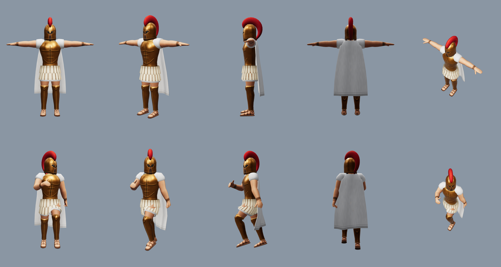

# Hoplite grec — personnage 3D pour jeu de stratégie

Personnage low poly prêt pour le jeu : hoplite au casque corinthien en bronze et cimier rouge, cuirasse musclée,
ptéryges de lin, jambières, sandales et cape. Style semi-réaliste stylisé (proportions normales, carrure
héroïque), silhouette lisible de loin, textures peintes.



| Fichier | Contenu |
|---|---|
| `hoplite.glb` | Personnage complet : maillage, squelette, poids, matériau et textures intégrés |
| `textures/hoplite_basecolor.png` | Couleur de base peinte, 2048 × 2048 |
| `textures/hoplite_roughness.png` | Rugosité, 2048 × 2048 |
| `textures/hoplite_metallic.png` | Métal (bronze en blanc), si le moteur le demande à part |
| `textures/hoplite_couleur_joueur.png` | Masque des zones à teinter (blanc = cape, manches, tunique) |
| `apercu*.png` | Rendus de contrôle (face, trois quarts, profil, dos, dessus ; pose de test ; détails) |
| `fabriquer.py` | Programme qui fabrique tout ce qui précède |

## Caractéristiques

- **7 222 triangles**, 6 723 sommets, un seul matériau, un seul appel de rendu.
- **Une texture 2048** : couleur de base + rugosité (dans le `.glb`, rugosité et métal sont réunis dans
  la texture « metal_rugosite » selon la norme glTF : vert = rugosité, bleu = métal).
- **Pose en T** : bras horizontaux, paumes vers le bas, pieds légèrement écartés, face à l'avant.
- **Sans socle, sans arme** : la lance et le bouclier sont à fabriquer à part.
- **Couleur du joueur** : cape, manches et bas de tunique peints en gris clair uni (ombres comprises),
  à multiplier par la couleur du joueur grâce au masque (voir `apercu-couleur-joueur.png`).
- **Échelle** : mètres, 1,89 m sans le cimier, 2,03 m avec. Y vers le haut, face vers +Z (norme glTF).
- **Squelette** : 65 os, noms et hiérarchie du squelette humanoïde Mixamo (`mixamorig:Hips`,
  `mixamorig:Spine` … `mixamorig:LeftHandIndex1` …), doigts compris ; 4 influences au plus par sommet.
  Contrôlé avec le validateur officiel glTF (Khronos) : 0 erreur, 0 avertissement.

## Utilisation dans un moteur

- **Unity** : importer le `.glb` (paquet glTFast), Rig → Humanoid ; la correspondance des os Mixamo est
  reconnue d'office, toutes les animations humanoïdes s'appliquent.
- **Unreal Engine 5** : importer le `.glb` (glTF Interchange), puis IK Retargeter avec le mannequin :
  la chaîne d'os est la même (bassin, trois vertèbres, cou, tête, clavicules, bras, avant-bras, mains,
  doigts, cuisses, jambes, pieds, orteils).
- **Animations Mixamo** : télécharger les animations « Without Skin » ; elles se reciblent par le nom
  des os (Blender, Unity Humanoid, Unreal). Mixamo n'accepte pas le `.glb` à l'envoi : pour utiliser son
  rig automatique à la place du nôtre, exporter d'abord en `.fbx` depuis Blender.
- **Teinte joueur** dans le shader : `couleur = base × lerp(1, couleur_joueur, masque)`.

## Limites à connaître

- Les ptéryges et la cape sont rigides (attachés au bassin et en partie aux cuisses) : sur un très grand
  pas, la cuisse peut traverser la jupe. Pour une cape qui flotte, ajouter une simulation de tissu ou
  quelques os dans le moteur.
- Le visage est peint dans l'ouverture du casque (yeux dans l'ombre, barbe) : pas de tête modélisée
  sous le casque, inutile à la distance d'un jeu de stratégie.
- Les os sont orientés comme le repère du monde (rotation nulle au repos) : les outils de reciblage
  s'en accommodent, mais une animation Mixamo copiée « telle quelle » sans reciblage serait faussée.

## Modifier le personnage

Tout est décrit en chiffres dans `fabriquer.py` (sections Cuirasse, Casque, Cimier, Bras, Jambes,
Tunique, Ptéryges, Cape ; couleurs dans `peindre_piece`). Après modification :

```
python3 design/3d/hoplite/fabriquer.py
```

Le programme refuse de terminer si le budget de 6 000 à 10 000 triangles n'est pas tenu.
Seuls numpy et Pillow sont nécessaires (environ 1 min 30).
